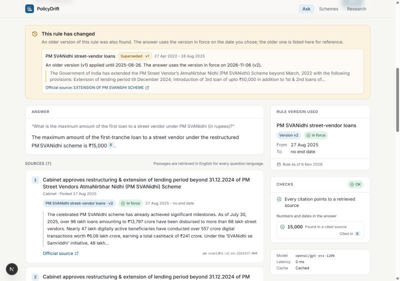
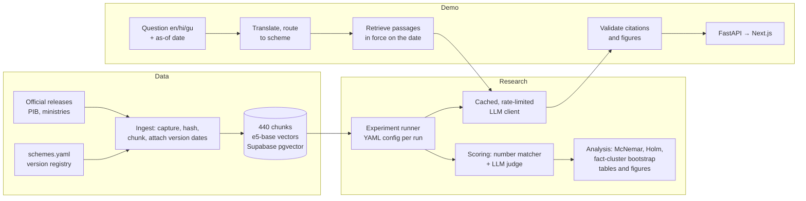

# PolicyDrift

**Do RAG agents answer from the rule they retrieved, or from the one they remember?**

Government rules change: loan limits, subsidy caps, tax rates, eligibility thresholds. A retrieval-augmented LLM can have the current rule in its context and still answer with an older one. PolicyDrift measures how often that happens for Indian government schemes in English, Hindi and Gujarati, tests which mitigations fix it, and ships the result as a working multilingual assistant that cites official sources, names the rule version it used and flags when a rule has changed.

Paper in progress: *Stale by Default: Measuring and Mitigating Outdated-Rule Answers in Multilingual Policy RAG Agents*.

**Live demo:** https://policydrift-lime.vercel.app (API: https://policydrift-api.vercel.app/api/health). The hosted demo uses BM25 retrieval because free serverless hosting cannot load the embedding model; see [docs/deploy.md](docs/deploy.md).



## What it does

- **Version-aware answers.** Every passage carries the effective window of the rule version it belongs to. The agent retrieves only passages in force on the chosen date and tells the model that date. These are the two mitigations that worked in the experiments.
- **Ask about the past.** Pick an "as of" date and get the rule that applied then, with a note that a newer version exists.
- **Rule-change flags.** Superseded versions of the same scheme are found and shown next to the answer, with their dates and official source.
- **Validated citations.** Every `[n]` marker must point at a passage the model was shown, and every figure in the answer must appear in a cited passage. Lakh/crore wording and Devanagari or Gujarati digits are compared as numbers.
- **English, Hindi, Gujarati.** Questions in any of the three, answers in the same language. Hindi and Gujarati questions are translated for retrieval and routed to the scheme they name.
- **Official sources only.** 46 releases from PIB and ministries, each recorded with its URL, SHA-256 and retrieval date in [data/SOURCES.md](data/SOURCES.md).

## The research

Pre-registered hypotheses ([docs/preregistration.md](docs/preregistration.md), frozen at git tag `prereg-freeze` before any test-split run):

- **H1:** RAG agents give outdated answers even when the current rule is retrieved.
- **H2:** this happens more in Hindi and Gujarati than in English.
- **H3:** mitigations reduce it, at different cost and latency.

**Benchmark (PolicyDrift-Bench).** 42 rule changes across 14 schemes (income tax, GST, MSP, PM Mudra, PM SVANidhi, PM Ujjwala, PMAY-Urban, KCC and others). 85 human-verified items, each asked in en, hi and gu (255 questions). The split is by scheme, and the test split is frozen and checksummed. The loader refuses to return it without an explicit `--final` flag.

**Conditions.** R0 no retrieval; R1 standard top-k RAG over all versions; R2 current version only; R3 both versions with effective dates; R4 both versions without dates. **Mitigations:** M-a1 date-stamped prompt, M-a2 validity statement, M-b conflict-checker agent, M-c version-filtered retrieval.

### Development-split findings (not confirmatory)

28 items, 14 facts, 3 models (gemini-3.1-flash-lite, gemini-3.5-flash-lite, gpt-oss-20b). Full tables are in [paper/dev/results.md](paper/dev/results.md) and the narrative in [docs/phase4_dev_results.md](docs/phase4_dev_results.md).

| Finding | Dev evidence |
|---|---|
| Models know the old rules | Closed-book (R0): 48–67% of answers give the outdated value |
| With only the current version retrieved, stale answers vanish | R2: 0.0% outdated |
| With both versions retrieved, stale answers return | R3: 24.2% overall; 10.0% (95% CI 1.1–20.4%) when the current value is in the context |
| In plain RAG, staleness is mostly a retrieval failure | R1: in 38 of 40 stale answers the current-version passage was never retrieved |
| A one-line date stamp fixes what the model can see | R3, current value in context, two Gemini models: M-a1 6.7% → 0.0% (9 fixed, 0 broken), at no extra cost |
| A conflict-checker agent works equally well at twice the cost | Same setting: M-b 6.7% → 0.0%, 2.1 calls and 2.2× tokens per answer; M-a2 (validity statement) does not help |
| Version filtering removes stale answers, but costs refusals and needs correct dates | R1: M-c 17.9% → 0.0%, with 13% refusals; with inverted dates, refusals nearly double |
| No Hindi or Gujarati penalty on dev | hi vs en: no difference; gu slightly better than en |

Intervals are bootstrapped over facts, since answers about the same fact are not independent. With 14 dev facts they are wide. The confirmatory test-split results (28 facts) are being produced by `scripts/finish_final.py` and will appear in `paper/test/`.

**Scorer validation.** A deterministic number matcher scores answers first and an LLM judge (gpt-oss-120b) handles the rest. Against 105 human labels the agreement is κ = 1.0 on a random sample of 45 and κ = 0.83 on a stratified sample of 60 that over-represents rare outcomes. Both samples were labelled by one person, which is a stated limitation.

## Architecture



The research pipeline and the demo share one Python package, `src/policydrift`. The API in `api/` is a thin layer over it.

| Area | Choices |
|---|---|
| Language models | Gemini and Groq free tiers behind one client: SQLite response cache keyed by request hash, per-provider rate limits, retries |
| Retrieval | `intfloat/multilingual-e5-base`, exact cosine search with scheme, version, language and date filters; pgvector schema for Supabase |
| Backend | Python 3.12, uv, pydantic, Typer CLI, FastAPI |
| Front end | Next.js 16, TypeScript (strict), Tailwind CSS; Noto Sans Devanagari and Gujarati |
| Quality | 128 tests (pytest), mypy strict, ruff; every experiment is one YAML config and one command |

## Run it

You need Python 3.12 with [uv](https://docs.astral.sh/uv/), Node 20 or newer, and free API keys for Groq (the demo) and Gemini (the experiments) in `.env` (see `.env.example`).

```bash
uv sync
uv run uvicorn api.main:app --port 8000
```

```bash
cd web && npm install && npm run dev
```

Open http://localhost:3000. To run the front end without the backend, set `NEXT_PUBLIC_DEMO_FIXTURES=1`.

## Reproduce the research

```bash
uv run policydrift ingest verify                                   # every source against its SHA-256
uv run policydrift run configs/experiments/dev-baseline.yaml       # one experiment, one command
uv run policydrift score runs/<run_id>                             # matcher, then the LLM judge
uv run policydrift paper --manifest paper/runs.dev.yaml            # all tables and figures
uv run pytest && uv run mypy src && uv run ruff check .
```

The final test run is `uv run --no-sync python scripts/finish_final.py` (see [docs/final_run.md](docs/final_run.md)). Every LLM response is cached, so a rerun costs no quota.

## Limitations

- Two of the three models share one provider and training lineage, and gpt-oss-20b was dropped from the final run because the free tier was too slow. This is logged in the deviation table.
- One person verified the benchmark and labelled the judge-calibration samples. Gujarati has no second check.
- Three dev facts are hard to retrieve: the passage with the current value is often not in the top-k. The demo routes to one scheme and shows 8 passages, which fixes the cases tested but is not a general guarantee.
- The Hindi and Gujarati interface text and answers need a native speaker's review.
- This is a research prototype. It is not legal or financial advice.

## Repository map

```
data/            sources, version registry, curated facts, benchmark (test split frozen)
src/policydrift/ ingest, retrieval, llm, bench, experiments, agents, scoring, analysis, citations, demo
api/             FastAPI app
web/             Next.js app
configs/         models, dev experiments, final (test) experiments
paper/           generated tables and figures (dev now, test after the final run)
docs/            pre-registration, related work, retrieval notes, dev results
```
